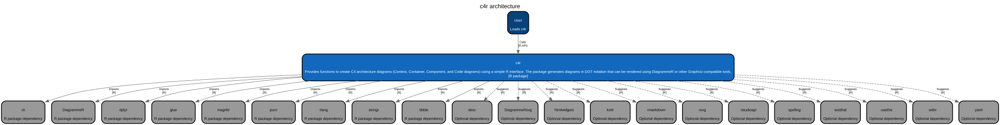

<!-- README.md is generated from README.Rmd. Please edit that file -->

```{r, include = FALSE}
knitr::opts_chunk$set(
  collapse = TRUE,
  comment = "#>",
  fig.path = "man/figures/README-",
  out.width = "100%"
)
library(c4r)
```

# c4r

<!-- badges: start -->
[](https://lifecycle.r-lib.org/articles/stages.html#experimental)
[](https://CRAN.R-project.org/package=c4r)
[](https://github.com/fabiandistler/c4r/actions/workflows/R-CMD-check.yaml)
[](https://app.codecov.io/gh/fabiandistler/c4r)
<!-- badges: end -->

c4r provides a simple R interface for creating C4 architecture diagrams. The package focuses on the first three levels of the C4 model (Context, Container, Component), generating diagrams using Graphviz DOT notation rendered through {DiagrammeR}. For the Code level, consider the [{flow}](https://github.com/moodymudskipper/flow) package.

## Installation

c4r is not yet available on CRAN. You can install the development version from GitHub:

``` r
# install.packages("pak")
pak::pak("fabiandistler/c4r")
```

## Quick Example

```{r, eval=FALSE}
library(c4r)

# Create a simple system context diagram
c4_context(
  title = "My System Context",
  person = list(c4_person("user", "User", "System user")),
  system = list(c4_system("app", "My App", "Does something useful")),
  relationships = list(c4_rel("user", "app", "Uses"))
)
```

## Learn More

- **[Getting Started Guide](https://fabiandistler.github.io/c4r/articles/getting-started.html)** - Complete tutorial with examples
- **[Function Reference](https://fabiandistler.github.io/c4r/reference/)** - API documentation

## Architecture

```{r architecture, echo=FALSE, message=FALSE, fig.alt="C4 context diagram of this package."}
.c4r_diagram <- c4r::c4_from_package(".") |> c4r::build_context()
if (requireNamespace("DiagrammeRsvg", quietly = TRUE)) {
  dir.create("man/figures", recursive = TRUE, showWarnings = FALSE)
  c4r::export_c4(.c4r_diagram, "man/figures/README-architecture", format = "svg")
  
} else {
  .c4r_diagram
}
```
